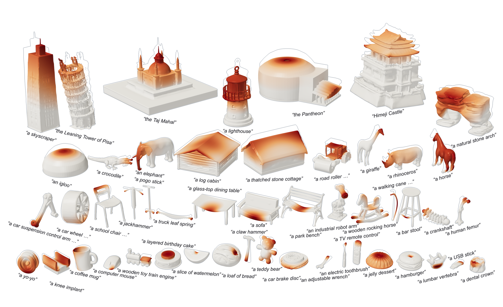

# MechFoundry: Autonomous generation, simulation and optimization of deformable real-world objects



## Installation

The solver and geometry generation run in one compute environment
(`mechfoundry-warp117`). The workflow interfaces and each optional model have their
own conda environment, because their dependencies conflict with the solver's.
Install the compute environment first, then only the parts you need. Run all
commands from the repository root. 

<details>
<summary>
Basic packages
</summary>

Install basic packages (taking CUDA 12.4 as an example):
```shell
conda create -n mechfoundry-warp117 python=3.10 -y
conda activate mechfoundry-warp117

conda install -c nvidia/label/cuda-12.4.0 -c conda-forge cuda-toolkit libstdcxx-ng -y
conda install -c conda-forge "numpy>=1.26.4,<2" "scipy<1.15" "pandas<2.1.0" matplotlib seaborn cmake compilers gcc=13.* gxx=13.* cython -y
python -m pip install torch torchvision torchaudio --index-url https://download.pytorch.org/whl/cu124
```
</details>


<details>
<summary>
TripoSG
</summary>

Fetch the TripoSG source. The script checks out the pinned upstream commit
(fc5c409) in `src/dependency/TripoSG`, applies the one-file patch in
`src/triposg_wrapper/patches/triposg.patch` (it restores the VAE's
`from torch_cluster import fps`, without which encoding a surface into a latent fails),
and verifies every file against a sha256 manifest. It is safe to rerun: a complete
folder is left as it is, `pretrained_weights/` and other untracked files are never
touched (weights downloaded first are fine), and a folder holding other TripoSG code
makes it stop and say what differs instead of overwriting it.
```shell
bash src/triposg_wrapper/fetch_triposg.sh
```

Install its requirements:
```shell
# Drop TripoSG's legacy NumPy pin; this project requires NumPy >=1.26.4. Drop diso too:
# it is a source package that imports torch to build, so pip's build isolation fails on it;
# it is built below without isolation. (mktemp, not a fixed /tmp name: on a shared machine
# another user's file of that name blocks it.)
REQ=$(mktemp --suffix=.txt)
sed -e '/^numpy==/d' -e '/^diso/d' src/dependency/TripoSG/requirements.txt > "$REQ"
python -m pip install "numpy>=1.26.4,<2" "scipy<1.15" -r "$REQ"
# Rebuild diso for your CUDA toolkit and GPU.
export TORCH_CUDA_ARCH_LIST="8.6" # Change this to your GPU's Compute Capability
python -m pip install diso --no-binary diso --no-build-isolation --no-cache-dir --force-reinstall --no-deps
python -c "import subprocess, sys, torch; subprocess.check_call([sys.executable, '-m', 'pip', 'install', 'torch-cluster', '-f', f'https://data.pyg.org/whl/torch-{torch.__version__}.html'])"
```

Optionally run a smoke test (this also downloads the checkpoints):
```shell
(cd src/dependency/TripoSG && python -m scripts.inference_triposg \
  --image-input assets/example_data/hjswed.png --faces 5000 --output-path ./output.glb)
```

The workflow fetches a missing variant on its first use (about 13 GB in all, a long
pause in the first session). To download all three ahead of time, including the
TripoSG-scribble that text and scribble inputs use:
```shell
for repo in VAST-AI/TripoSG VAST-AI/TripoSG-scribble briaai/RMBG-1.4; do
  hf download $repo --local-dir src/dependency/TripoSG/pretrained_weights/${repo#*/}
done
```
</details>

<details>
<summary>
Warp and AMGX
</summary>

FEM, adjoints, and filtering run on [Warp](https://github.com/NVIDIA/warp)
(float32 by default; `use_mixed_precision=True` selects float64, which the
API-assisted workflow uses by default). Assembled
systems are solved with AMG-preconditioned CG through
[AMGX](https://github.com/NVIDIA/AMGX); matrix-free systems use Jacobi CG.
`cg_backend_assembled` selects `"amgx"` (JAX-AMG, falling back to pyamgx),
`"jaxamg"`, `"pyamgx"`, or `"native"` (Warp CG, no AMGX needed).

```shell
# The workflow's tools also run here: pydantic validates the BC proposal they resolve
# (workflow_tool.py resolve-bcs, build-case), and manifold3d unions the members of the
# AI operator's dimensioned blanks (operator_skill/scripts/union_blank.py).
python -m pip install warp-lang==1.17.0 pytest pytest-cov "pydantic>=2.7,<3" "manifold3d>=3.5,<4"
```

Build AMGX (single-GPU, without MPI):

```shell
test -d src/dependency/amgx/.git || git clone --recursive https://github.com/NVIDIA/AMGX.git src/dependency/amgx
# The tested commit (v2.5.0-5); AMGX main moves (2026-07: CUDA 13 changes).
git -C src/dependency/amgx checkout 3188dce5bdc22e96407d609e398925bed6aa010d
git -C src/dependency/amgx submodule update --init --recursive
mkdir -p src/dependency/amgx/build-warp117
(
cd src/dependency/amgx/build-warp117
# Set CMAKE_CUDA_ARCHITECTURES to your GPU's compute capability.
cmake \
  -DCMAKE_CUDA_ARCHITECTURES=86 \
  -DCUDA_TOOLKIT_ROOT_DIR=$CONDA_PREFIX \
  -DCMAKE_C_COMPILER=$CC \
  -DCMAKE_CXX_COMPILER=$CXX \
  -DCMAKE_NO_MPI=true \
  -DCMAKE_DISABLE_FIND_PACKAGE_MPI=TRUE \
  ..
cmake --build . -j"$(nproc)"
./examples/amgx_capi -m ../examples/matrix.mtx -c ../src/configs/FGMRES_AGGREGATION.json
)
```

Install [pyamgx](https://github.com/shwina/pyamgx):

```shell
test -d src/dependency/pyamgx/.git || git clone https://github.com/shwina/pyamgx.git src/dependency/pyamgx
(
cd src/dependency/pyamgx
export AMGX_DIR=$(realpath ../amgx)
export AMGX_BUILD_DIR=$AMGX_DIR/build-warp117
python -m pip install . --no-build-isolation
)
python -c "import pyamgx; pyamgx.initialize(); print('pyamgx OK'); pyamgx.finalize()"
```

Install [JAX-AMG](https://github.com/jx-wang-s-group/JAX-AMG) against the same
CUDA and AMGX libraries:

```shell
export CUDA_HOME="$CONDA_PREFIX"
export AMGX_ROOT="$(realpath src/dependency/amgx)"
export AMGX_BUILD="$AMGX_ROOT/build-warp117"
export LIBRARY_PATH="$AMGX_BUILD:$CUDA_HOME/lib${LIBRARY_PATH:+:$LIBRARY_PATH}"
export LD_LIBRARY_PATH="$AMGX_BUILD:$CUDA_HOME/lib${LD_LIBRARY_PATH:+:$LD_LIBRARY_PATH}"
export JAXAMG_ENABLE_MPI=0
export XLA_PYTHON_CLIENT_PREALLOCATE=false

python -m pip install \
  "numpy==1.26.4" \
  "scipy==1.14.1" \
  "jax[cuda12-local]==0.5.3" \
  "jaxamg==0.1.4"

python - <<'PY'
import jax, jax.numpy as jnp, jaxamg, numpy as np
from scipy.sparse import eye

assert any(device.platform == "gpu" for device in jax.devices())
x, info = jaxamg.solve(eye(8, dtype=np.float32, format="csr"), jnp.ones(8))
assert info["status"] == jaxamg.AMGXStatus.SUCCESS
np.testing.assert_allclose(np.asarray(x), np.ones(8), rtol=1e-5)
print("JAX", jax.__version__, "JAX-AMG", jaxamg.__version__, jax.devices())
jaxamg.finalize()
PY
python -m pip check
```

JAX shares the GPU with Warp and Torch, so stop it from preallocating most of
the GPU memory in this environment:

```shell
mkdir -p "$CONDA_PREFIX/etc/conda/activate.d"
printf '%s\n' 'export XLA_PYTHON_CLIENT_PREALLOCATE=false' \
  > "$CONDA_PREFIX/etc/conda/activate.d/jax-memory.sh"
```
</details>

<details>
<summary>
CLI, Web UI, and AI assistants
</summary>

```shell
conda create -n mechfoundry-agents python=3.11 -y
conda activate mechfoundry-agents
python -m pip install \
  "langgraph==1.2.11" \
  "langgraph-checkpoint-sqlite==3.1.1" \
  "openai>=1.40,<4" \
  "groq>=1.0,<2" \
  "google-genai>=1.0,<2" \
  "pillow>=10,<13" \
  "pydantic>=2.7,<3" \
  "streamlit>=1.40,<2" \
  "streamlit-drawable-canvas>=0.13,<1" \
  "trimesh>=4,<6" \
  "scipy>=1.14,<2" \
  "pytest>=8,<10" \
  "huggingface_hub>=0.34,<2"
```

`huggingface_hub` provides the `hf` command that the optional models' weight downloads
below use (huggingface_hub 0.34 introduced it).

Set an API key for each provider you use (DeepSeek is the default), then
reactivate the environment. Do not commit keys.

```shell
conda env config vars set -n mechfoundry-agents DEEPSEEK_API_KEY="your-api-key"
# or GROQ_API_KEY / GEMINI_API_KEY
conda activate mechfoundry-agents
```

### Command-line workflow

```shell
python src/agents_wrapper/fem_workflow/run_workflow.py start --compute-env mechfoundry-warp117

# Other providers; text and image roles may use different ones:
python src/agents_wrapper/fem_workflow/run_workflow.py start \
  --provider gemini --compute-env mechfoundry-warp117
python src/agents_wrapper/fem_workflow/run_workflow.py start \
  --provider deepseek --vision-provider groq \
  --vision-model qwen/qwen3.8-27b --compute-env mechfoundry-warp117

# Resume a checkpointed session without repeating cached API calls:
python src/agents_wrapper/fem_workflow/run_workflow.py resume SESSION_ID
```

The workflow turns a text, image, or scribble description into a generated
surface, previews segmented boundary regions, collects material parameters, and
runs a `ShapeOptTrimmed` forward solve (or, if selected, shape optimization).

### Chat frontend

```shell
conda activate mechfoundry-agents
streamlit run src/ui/app.py
```

For remote use, bind to loopback on the server and tunnel from your machine:

```shell
# server
streamlit run src/ui/app.py --server.address 127.0.0.1 --server.port 8501 --server.headless true
# local machine (add -i KEY / -p PORT as needed)
ssh -N -L 8501:127.0.0.1:8501 USER@REMOTE_HOST
```

Then open `http://127.0.0.1:8501`.

See [`src/agents_wrapper/fem_workflow/README.md`](src/agents_wrapper/fem_workflow/README.md)
for details.
</details>

<details>
<summary>(Recommended) Optional PartField surface segmentation</summary>

[PartField](https://github.com/nv-tlabs/PartField) can replace the built-in
shape-diameter segmentation with learned part features. It needs its own
environment; the pins below are tested together (in particular, newer cuML
wheels replace Torch's CUDA libraries). Its NVIDIA license limits use to
non-commercial research and education.

```shell
test -d src/dependency/PartField/.git || git clone https://github.com/nv-tlabs/PartField.git src/dependency/PartField
git -C src/dependency/PartField checkout 373025dbd283bb44cc4a6dc78c99994dbc91de32

conda create -n mechfoundry-partfield python=3.10 -y
conda activate mechfoundry-partfield
python -m pip install setuptools==75.8.2
python -m pip install torch==2.4.0 torchvision==0.19.0 torchaudio==2.4.0 \
  --index-url https://download.pytorch.org/whl/cu124
python -m pip install "numpy==1.26.4" "lightning==2.2.*" h5py yacs \
  "trimesh==4.6.6" scikit-image pytz \
  loguru boto3 mesh2sdf tetgen pymeshlab "plyfile==1.0.3" einops libigl polyscope \
  potpourri3d simple_parsing arrgh open3d vtk scikit-learn huggingface_hub
python -m pip install torch-scatter \
  -f https://data.pyg.org/whl/torch-2.4.0+cu124.html
python -m pip install --extra-index-url https://pypi.nvidia.com \
  "cuda-python==12.4.0" "cupy-cuda12x==13.3.0" "cuml-cu12==24.8.0"
python -m pip check

mkdir -p src/dependency/PartField/model
hf download mikaelaangel/partfield-ckpt model_objaverse.ckpt \
  --local-dir src/dependency/PartField/model

python -c "import torch, cupy, cuml; print(torch.__version__, torch.version.cuda, cupy.__version__, cuml.__version__); assert torch.cuda.is_available()"
```

Headless Linux may also need `libx11-6`, `libgl1`, and `libxrender1`. Verify
discovery from `mechfoundry-agents`:

```shell
conda activate mechfoundry-agents
python -c "from src.partfield_wrapper import partfield_status; s = partfield_status(); print(s); assert s.ready"
```

When ready, **PartField** becomes the default segmentation method in the
workflow. Override the defaults with `PARTFIELD_CONDA_ENV`, `PARTFIELD_ROOT`,
or `PARTFIELD_CHECKPOINT`.
</details>

<details>
<summary>Optional Text2CAD text-to-CAD generator</summary>

[Text2CAD](https://github.com/SadilKhan/Text2CAD) (NeurIPS 2024, CC BY-NC-SA
4.0) builds CAD parts (sketches, extrusions, booleans) from text. It is offered
as a text-only alternative to TripoSG in the workflow, and its parts are
segmented by their own CAD faces. **Always use Revise prompt with it:** it does
not know object names ("a hex nut" alone gives a box), and the revision rewrites
the name as the geometry it can build. The checkpoint sits in a gated dataset:
accept its terms (approval is automatic) on
[the dataset page](https://huggingface.co/datasets/SadilKhan/Text2CAD) and run
`hf auth login` first.

```shell
test -d src/dependency/Text2CAD/.git || git clone https://github.com/SadilKhan/Text2CAD.git src/dependency/Text2CAD
git -C src/dependency/Text2CAD checkout 669a81472ede2269837c22a4d00070eaac360c82

conda env create -f src/dependency/Text2CAD/environment.yml -n mechfoundry-text2cad
conda activate mechfoundry-text2cad
# The file's unpinned `cuda` resolves to CUDA 13, for which PyTorch 2.2.1 has no
# build, so conda installs the CPU one. Swap in the CUDA 12.1 wheels.
conda remove --force pytorch torchvision -y
python -m pip install torch==2.2.1 torchvision==0.17.1 --index-url https://download.pytorch.org/whl/cu121
python -m pip install pytest

W=src/dependency/Text2CAD/pretrained_weights
hf download SadilKhan/Text2CAD text2cad_v1.0/Text2CAD_1.0.pth --repo-type dataset --local-dir $W
hf download google-bert/bert-large-uncased config.json tokenizer.json tokenizer_config.json \
  vocab.txt model.safetensors --cache-dir $W/hf_cache

python src/cad_wrapper/text2cad_wrapper/generate.py --prompt "A ring." --output output/smoke/ring.glb
```

Verify discovery from `mechfoundry-agents`:

```shell
conda activate mechfoundry-agents
python -c "from src.cad_wrapper.text2cad_wrapper import text2cad_status; s = text2cad_status(); print(s); assert s.ready"
```

Then choose **Text2CAD** as the generator for a text input. Override the
defaults with `TEXT2CAD_CONDA_ENV`, `TEXT2CAD_ROOT`, or `TEXT2CAD_CHECKPOINT`.
</details>

<details>
<summary>Optional CAD-Coder text-to-CAD generator (runs generated code)</summary>

[CAD-Coder](https://github.com/gudo7208/CAD-Coder) (NeurIPS 2025, Apache-2.0,
Qwen2.5-7B, about 16 GB of GPU memory) writes a CadQuery script for the part. It
follows expert-level descriptions (explicit sketch coordinates) faithfully but
does not know object names, so **always use Revise prompt with it**: the API
model writes that description ("a hex nut" -> hexagon and bore coordinates). Its parts are
segmented by their own CAD faces, as Text2CAD's are.

**The generated script is executed.** It runs only in a child process that
accepts CadQuery/math/numpy code passing an AST allowlist, with reduced builtins,
memory, CPU and file-size limits, a throwaway directory, no credentials, and no
network (`unshare -rn` where the kernel allows it); see
`src/cad_wrapper/cadcoder_wrapper/sandbox.py`.

```shell
test -d src/dependency/CAD-Coder/.git || git clone https://github.com/gudo7208/CAD-Coder.git src/dependency/CAD-Coder
git -C src/dependency/CAD-Coder checkout 24c04e72d869b216c934b77a7efc43741185fa94

conda create -n mechfoundry-cadcoder python=3.10 -y
conda activate mechfoundry-cadcoder
python -m pip install torch==2.6.0 --index-url https://download.pytorch.org/whl/cu124
python -m pip install transformers==5.17.0 accelerate==1.15.0 "numpy<2.0" "cadquery==2.3.1" \
  trimesh==5.1.0 scipy pytest

hf download gudo7208/CAD-Coder --local-dir src/dependency/CAD-Coder/pretrained_weights/CAD-Coder

python -m pytest src/cad_wrapper/cadcoder_wrapper/tests   # includes the sandbox's refusal tests
```

Verify discovery from `mechfoundry-agents`:

```shell
conda activate mechfoundry-agents
python -c "from src.cad_wrapper.cadcoder_wrapper import cadcoder_status; s = cadcoder_status(); print(s); assert s.ready"
```

Override the defaults with `CADCODER_CONDA_ENV`, `CADCODER_ROOT`, or `CADCODER_WEIGHTS`.
</details>

<details>
<summary>(Recommended) Optional Hunyuan3D-2.1 image-to-3D generator and surface painter (with colour)</summary>

[Hunyuan3D-2.1](https://github.com/Tencent-Hunyuan/Hunyuan3D-2.1) (Tencent
Hunyuan Community License: non-commercial, and not licensed in the EU, the UK or
South Korea) builds a shape from an image and paints it from the same image. It is
offered as an image-only alternative to TripoSG, and keeps the object's colour on
the surface as vertex colours. Its paint stage also colours any other surface
(from TripoSG, a CAD generator or an upload) for VoMP, from a reference image or,
with the SDXL weights below, a description. Both stages stay loaded, about 30 GB
of GPU memory, and about 7 GB more once a description has been painted from.
No download is gated.

```shell
test -d src/dependency/Hunyuan3D-2.1/.git || git clone https://github.com/Tencent-Hunyuan/Hunyuan3D-2.1.git src/dependency/Hunyuan3D-2.1
git -C src/dependency/Hunyuan3D-2.1 checkout 82920d643c0dc2f7bfd7255f45f62d386edfe60c
H=src/dependency/Hunyuan3D-2.1

conda create -n mechfoundry-hunyuan3d python=3.10 -y
conda activate mechfoundry-hunyuan3d
conda install -c nvidia/label/cuda-12.4.0 -c conda-forge cuda-toolkit gcc=13.* gxx=13.* -y
python -m pip install torch==2.5.1 torchvision==0.20.1 torchaudio==2.5.1 --index-url https://download.pytorch.org/whl/cu124
# Upstream's requirements from PyPI, without the two mirror indexes the file lists.
# bpy 4.0 for Python 3.10 is only on Blender's own index; setuptools 81+ lacks the
# pkg_resources that pytorch-lightning 1.9 imports.
REQ=$(mktemp --suffix=.txt)
grep -v '^--extra-index-url' $H/requirements.txt > "$REQ"
python -m pip install -r "$REQ" pytest --extra-index-url https://download.blender.org/pypi/
python -m pip install "setuptools<81"
# The two extensions; the rasterizer needs torch at build time, hence no build isolation.
# TORCH_CUDA_ARCH_LIST: your GPU's compute capability (8.6 for an RTX A6000).
(cd $H/hy3dpaint/custom_rasterizer && TORCH_CUDA_ARCH_LIST=8.6 python -m pip install --no-build-isolation -e .)
(cd $H/hy3dpaint/DifferentiableRenderer && bash compile_mesh_painter.sh)
wget https://github.com/xinntao/Real-ESRGAN/releases/download/v0.1.0/RealESRGAN_x4plus.pth -P $H/hy3dpaint/ckpt
wget https://github.com/danielgatis/rembg/releases/download/v0.0.0/u2net.onnx -P $H/pretrained_weights/u2net

# The model weights (about 19 GB), with the hf of mechfoundry-agents: this environment's
# huggingface-hub 0.30 predates the hf command.
conda activate mechfoundry-agents
hf download tencent/Hunyuan3D-2.1 --include "hunyuan3d-dit-v2-1/*" --include "hunyuan3d-vae-v2-1/*" \
  --include "hunyuan3d-paintpbr-v2-1/*" --cache-dir $H/pretrained_weights/hf_cache/hub
hf download facebook/dinov2-giant --include "*.json" --include "*.safetensors" \
  --cache-dir $H/pretrained_weights/hf_cache/hub

conda activate mechfoundry-hunyuan3d
python -m pytest src/hunyuan3d_wrapper/tests
python src/hunyuan3d_wrapper/generate.py --input $H/assets/demo.png --output output/smoke/demo.glb
```

Verify discovery from `mechfoundry-agents`:

```shell
conda activate mechfoundry-agents
python -c "from src.hunyuan3d_wrapper import hunyuan3d_status; s = hunyuan3d_status(); print(s); assert s.ready"
```

Then upload an image and choose **Hunyuan3D-2.1** as the generator. Override the
defaults with `HUNYUAN3D_CONDA_ENV`, `HUNYUAN3D_ROOT`, or `HUNYUAN3D_WEIGHTS`
(the Hugging Face cache holding the weights).

The same paint stage also colours surfaces it did not generate, for VoMP (see
below). Painting from a description draws the reference image with SDXL and a
depth ControlNet, which is about 10 GB more (OpenRAIL++ licences, not gated):

```shell
conda activate mechfoundry-agents
hf download madebyollin/sdxl-vae-fp16-fix --include config.json \
  --include diffusion_pytorch_model.safetensors --cache-dir $H/pretrained_weights/hf_cache/hub
hf download diffusers/controlnet-depth-sdxl-1.0 --include config.json \
  --include diffusion_pytorch_model.fp16.safetensors --cache-dir $H/pretrained_weights/hf_cache/hub
hf download stabilityai/stable-diffusion-xl-base-1.0 --include model_index.json \
  --include "scheduler/*" --include "tokenizer/*" --include "tokenizer_2/*" --include "*/config.json" \
  --include "text_encoder*/model.fp16.safetensors" --include "unet/diffusion_pytorch_model.fp16.safetensors" \
  --include "vae/diffusion_pytorch_model.fp16.safetensors" --cache-dir $H/pretrained_weights/hf_cache/hub
python -c "from src.hunyuan3d_wrapper.availability import texture_status; s = texture_status(); print(s); assert s.ready"

# Paint an existing surface from a description: same vertices and faces, plus vertex
# colours, and the reference image SDXL drew for it.
conda activate mechfoundry-hunyuan3d
python src/hunyuan3d_wrapper/generate.py --surface output/smoke/demo.glb --prompt "weathered oak and brass" \
  --reference output/smoke/demo_reference.png --output output/smoke/demo_painted.glb
```
</details>

<details>
<summary>Optional VoMP adaptive material assignment</summary>

[VoMP](https://github.com/nv-tlabs/VoMP) predicts volumetric Young's modulus,
Poisson ratio, and density. It is separate from PartField/shape-diameter surface
segmentation, which still selects boundary-condition regions. Keep VoMP in its
own environment; its PyTorch/CUDA extension stack is not compatible with the
`mechfoundry-warp117` solver environment (the upstream installer pins PyTorch 2.4
and CUDA 11.8, while this repository's solver uses PyTorch 2.6/CUDA 12.4).

```shell
test -d src/dependency/VoMP/.git || git clone https://github.com/nv-tlabs/VoMP.git src/dependency/VoMP
git -C src/dependency/VoMP checkout ac6826f25ca5cfa122eb7bacb74be91b5a9eadf4

# Do not leak the solver environment's GCC 13/CUDA paths into CUDA 11.8 builds.
unset CC CXX CUDA_HOME

# Create and activate the environment first: the installer's first command,
# `pip install --upgrade pip wheel setuptools pytest`, runs before it activates
# anything, so it would otherwise upgrade whichever environment is active (base,
# or mechfoundry-hunyuan3d, whose setuptools must stay below 81).
conda create -n mechfoundry-vomp python=3.10 -y
conda activate mechfoundry-vomp

# The upstream installer is interactive. Answer Yes to: install into the existing
# environment, CUDA 11.8, PyTorch 2.4, diff-gaussian-rasterization, the prebuilt
# FlashAttention, spconv, Kaolin, inference requirements, and Blender (asked only
# when it is not already unpacked in src/dependency/VoMP; its two sudo apt-get
# questions can be No when libxrender1 libxi6 libxkbcommon-x11-0 libsm6 are
# installed). Answer No to the
# OpenGL/EGL system packages (sudo apt-get; only for VoMP's own GUI), TensorRT,
# dev requirements and the training initialization weights.
# CONDA_AUTO_ACTIVATE_BASE=false: the installer runs under `set -o nounset` and
# evaluates `conda shell.bash hook`, which re-activates base; on an Anaconda base
# with qt-main, its activate script reads an unset QT_XCB_GL_INTEGRATION and the
# installer exits right after the EGL question.
CONDA_AUTO_ACTIVATE_BASE=false bash src/dependency/VoMP/install_env.sh mechfoundry-vomp

conda activate mechfoundry-vomp
# Check that the Gaussian-splat rasterizer links CUDA 11 (libcudart.so.11.0).
# If it names libcudart.so.12 or an RPATH into another environment, it was
# built with that environment's toolchain and aborts with "stack smashing
# detected" on the first splat; rebuild it with this environment's nvcc 11.8.
readelf -d "$(python -c 'import diff_gaussian_rasterization as d, os; print(os.path.dirname(d.__file__))')"/_C*.so | grep -i "cudart\|rpath"
(unset CC CXX LDFLAGS CFLAGS CXXFLAGS; export TORCH_CUDA_ARCH_LIST=8.6  # your GPU's arch
 python -m pip install --no-build-isolation --no-deps --force-reinstall \
   "git+https://github.com/graphdeco-inria/diff-gaussian-rasterization.git@59f5f77e3ddbac3ed9db93ec2cfe99ed6c5d121d")

python -m pip install huggingface_hub
hf download nvidia/PhysicalAI-Simulation-VoMP-Model \
  --revision f9639381b6b8012a8a975b5b9503aa2ea04f5709 \
  --local-dir src/dependency/VoMP/weights

# Only needed when Blender is not at VoMP's installer-managed default path.
# Export this in the shell that launches the UI (direct launch does not activate
# the VoMP environment or import its conda environment variables).
export VOMP_BLENDER=/absolute/path/to/blender
```

Check the optional runtime from the UI environment:

```shell
conda activate mechfoundry-agents
python -c "from src.vomp_wrapper.availability import vomp_status; s=vomp_status(); print(s); assert s.ready"
```

Choose **Infer spatial field with VoMP** on the material card. The workflow
starts the `mechfoundry-vomp` interpreter directly (not through `conda run`), keeps
the model warm, caches rendering/inference, and asks for approval before the
forward solve. Uniform material remains the default and does not import or probe
VoMP. Adaptive fields are currently forward-solve-only. Density contributes to
static loading only through `body_force + density * acceleration`.

VoMP reads colour as well as shape. A surface without colour (an uploaded mesh,
TripoSG or a CAD generator) is offered an optional paint card right after it
arrives, before scaling: painted there, its colours are in the views that the
geometry reading, boundary-condition synthesis and material steps use. Skipped
there, it must be painted in the VoMP card before VoMP runs: describe its
look, or give a reference image, and **Generate texture** runs Hunyuan3D-2.1's
paint stage on it. The geometry is unchanged; only vertex colours are added, and
VoMP reads that painted copy. A coloured surface, such as Hunyuan3D-2.1's own,
can be repainted there optionally, with a new seed, description or image. The
painter needs the Hunyuan3D-2.1 setup above (plus the SDXL weights for
descriptions); a repaint takes about a minute on a warm worker.

VoMP and its model are optional external dependencies; review their upstream
licenses and model-card limitations before use.
</details>


<details>
<summary>
Run the test suites
</summary>

```shell
# mechfoundry-warp117
(cd src/warp_wrapper && bash tests/run_all.sh)
python -m pytest src/triposg_wrapper/tests

# mechfoundry-agents
python -m pytest src/agents_wrapper/tests src/partfield_wrapper/tests src/cad_wrapper/text2cad_wrapper/tests \
  src/cad_wrapper/cadcoder_wrapper/tests src/hunyuan3d_wrapper/tests

# mechfoundry-text2cad, mechfoundry-cadcoder and mechfoundry-hunyuan3d (add the model-side tests)
python -m pytest src/cad_wrapper/text2cad_wrapper/tests
python -m pytest src/cad_wrapper/cadcoder_wrapper/tests
python -m pytest src/hunyuan3d_wrapper/tests

# mechfoundry-vomp (VoMP's wrapper needs its own environment's scipy and torch)
python -m pytest src/vomp_wrapper/tests
```

Warp JIT compilation makes the first run slower.
</details>

## Quick start

### With a coding agent you operate

[`AGENTS.md`](AGENTS.md) is the entry point for a coding agent you drive yourself
(Claude Code, Codex, ...): it explains the repository and points to the operator
skill, [`src/agents_wrapper/fem_workflow/operator_skill/SKILL.md`](src/agents_wrapper/fem_workflow/operator_skill/SKILL.md),
which takes one object from a sentence to a solved, checked and reported case.
Start the agent in the repository root and ask, for example:

```shell
claude "Follow AGENTS.md and simulate a park bench."
```

### Headless batch with Claude Code

`experiments/agentic_batch/run_batch.sh` gives each line of a list to its own headless
Claude Code session following the operator skill. It needs the `claude` CLI on `PATH`
and logged in, `mechfoundry-warp117` and `mechfoundry-agents` installed (with
`DEEPSEEK_API_KEY` set in `mechfoundry-agents`, as above), an idle GPU, and the main
checkout (a git worktree lacks `src/dependency/`).

```shell
# One object name per line; blank lines and lines starting with # are skipped.
cat > output/my_objects.txt <<'EOF'
a park bench
a coffee mug
a step stool
EOF
experiments/agentic_batch/run_batch.sh --dry-run output/my_objects.txt   # lists the runs, starts nothing
# One run at a time on GPU 0, with Sonnet (--model haiku|sonnet|opus, --effort low..max)
experiments/agentic_batch/run_batch.sh -j 1 --gpus 0 --model sonnet --out output/my_batch output/my_objects.txt
```

Each object gets `output/my_batch/<object>-<timestamp>/`, with the workflow session
(`workflow/<session_id>/`), the agent's reply (`agent_reply.md`) and `metrics.json`;
the batch's `summary.csv` is in `output/my_batch/_batches/<batch_id>/`. All options are
in the script header; the paper's 50-object batches are under
[Agentic batch runs](#agentic-batch-runs).

## Paper results reproduction

> **Not bit-for-bit reproducible.** The AI operator and its AI subagents (Claude Code
> sessions and the workflow's own LLM calls) and the GPU runs (generation, segmentation,
> painting, FEA) are non-deterministic. Re-running the commands below will not reproduce
> the paper's results identically, but should give results of similar quality when all
> environments are configured and accessible: every conda environment above, the optional
> model checkpoints, and the API keys and logins (DeepSeek, Claude Code, Hugging Face).

### Archived run outputs

The paper's run outputs are released on Zenodo: <https://zenodo.org/records/23511564>.

<details>
<summary>
The archives, where to put them and how to extract them
</summary>

Put the `.tar.zst` archives in `output/archives/`. Each one unpacks to its original folder
under `output/`, where the scripts and figure builds expect it:

```shell
zstd -dc output/archives/<name>.tar.zst | tar -x -C output    # -> output/<name>/
```

| Archive | Contents | Needed by |
|---|---|---|
| `agentic_batch50_opus.tar.zst` | Opus 50-object batch: one run folder (sessions, transcript, metrics) per object | `illustrations/build.sh agenticresults`, `gallery`, `agenticcompare`; `model_eval`, `bodyfitted_vs_nitsche`, `geometry_cleanup` |
| `agentic_batch50.tar.zst` | Sonnet 50-object batch | `agenticcompare`, Sonnet category pages; `model_eval` |
| `agentic_batch50_haiku.tar.zst` | Haiku 50-object batch | `agenticcompare`, Haiku category pages; `model_eval` |
| `showcase.tar.zst` | geometry realizations, material and BC sweeps (`realizations/`, `material_sweep/`, `bc_sweep/`) | `illustrations/build.sh showcase` |
| `bodyfitted_vs_nitsche.tar.zst` | per-object Nitsche and body-fitted P1 solves, `_summary/` | re-evaluating or re-summarizing that experiment |
| `geometry_cleanup.tar.zst` | per-object clean-up runs, logs, contact sheets | re-rendering row c of `shapeoptmerged` (`SOM_CU_RENDER=1`) |

</details>

### Agentic batch runs

`experiments/agentic_batch/run_batch.sh` runs the FEM operator skill on a list of
objects, one headless Claude Code session per object.

<details>
<summary>
Batch commands for Haiku, Sonnet and Opus
</summary>

The options are listed in the script header. The runs below used Claude Code 2.1.296 on
2026-10-13, with the default effort (`medium`).

```shell
LIST=experiments/agentic_batch/objects_50.txt
# Sonnet (claude-sonnet-5-5), two runs at a time on GPUs 0 and 1
experiments/agentic_batch/run_batch.sh -j 2 --gpus 0,1 --model sonnet --out output/agentic_batch_sonnet $LIST
# Haiku (claude-haiku-5-5) and Opus (claude-opus-5-5), one run at a time on one GPU each;
# start concurrent batches a few seconds apart
experiments/agentic_batch/run_batch.sh -j 1 --gpus 0 --model haiku --out output/agentic_batch_haiku $LIST
experiments/agentic_batch/run_batch.sh -j 1 --gpus 1 --model opus --out output/agentic_batch_opus $LIST
```

The batches of the paper are `output/agentic_batch50` (Sonnet), `…_haiku` and `…_opus`
(archived, above). The realization, material and BC sweeps behind the showcase figure are
run by `run_realizations.sh`, `run_material_sweep.sh` and `run_bc_sweep.sh`; see
[`experiments/agentic_batch/README.md`](experiments/agentic_batch/README.md).

</details>

### Experiments

`experiments/` holds the studies behind the paper, each with a README; extract the
archives they read first (above).

<details>
<summary>
<code>agentic_batch/</code>: the batch runner
</summary>

[`experiments/agentic_batch/`](experiments/agentic_batch/README.md) is the batch runner
above, one headless Claude Code session per object following the
[operator skill](src/agents_wrapper/fem_workflow/operator_skill/SKILL.md), plus the
showcase sweeps. Outputs go to `--out` under `output/`.

</details>

<details>
<summary>
<code>model_eval/</code>: three-evaluator grading of the batches
</summary>

In [`experiments/model_eval/`](experiments/model_eval/README.md), three blinded evaluator
agents grade the Haiku, Sonnet and Opus batches on geometry, boundary conditions and
material. The Fable round is at the top level and the GPT-6-Astra round in `astra_high/`
(`agreement.md` compares them); `combine.py` writes `evaluation_table.{md,xlsx}`. Needs
the three batch archives.

</details>

<details>
<summary>
<code>bodyfitted_vs_nitsche/</code>: diffused Nitsche vs body-fitted P1
</summary>

[`experiments/bodyfitted_vs_nitsche/`](experiments/bodyfitted_vs_nitsche/README.md) solves
each Opus session with the diffused-Nitsche solver and with body-fitted P1 tetrahedra
(TetGen), at octree depths 7 and 8 (`run_batch.py`, then `summarize.py`). The summary
and the SI tables are kept in `summary/` and `summary/tables/`; the raw outputs are
`bodyfitted_vs_nitsche.tar.zst`.

</details>

<details>
<summary>
<code>geometry_cleanup/</code>: volume-as-is clean-up of the generated bodies
</summary>

[`experiments/geometry_cleanup/`](experiments/geometry_cleanup/README.md) runs a short
volume-as-is shape optimization of the 50 Opus bodies that smooths generation defects,
with an early stop on surface movement (`setup.py`, `run_queue.sh`, `summarize.py`).
Its outputs are `geometry_cleanup.tar.zst`.

</details>
